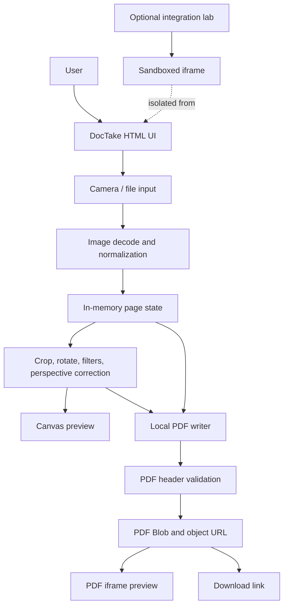
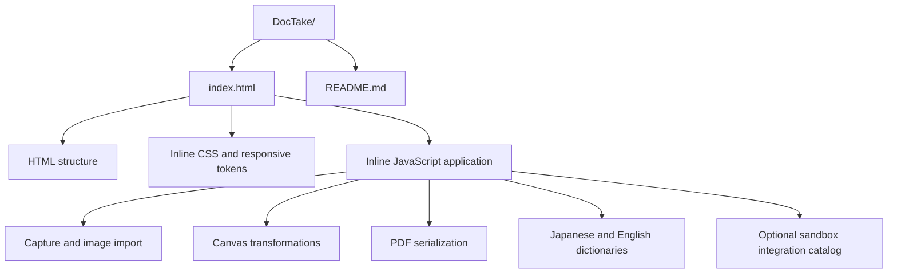
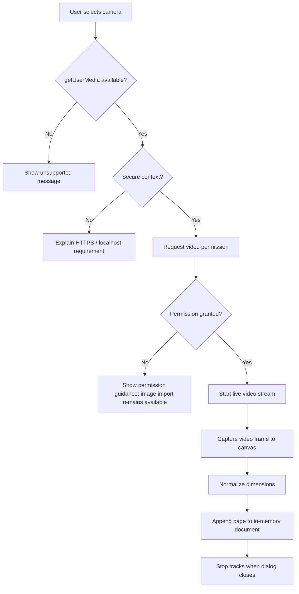
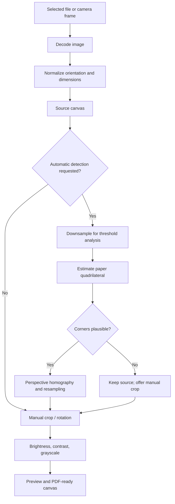
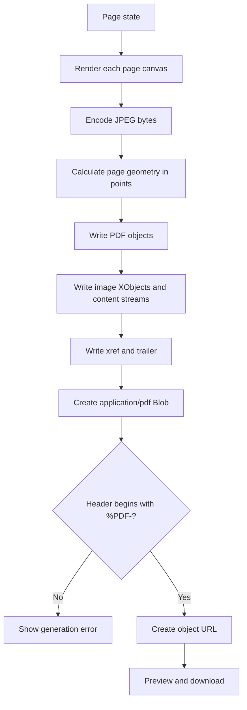
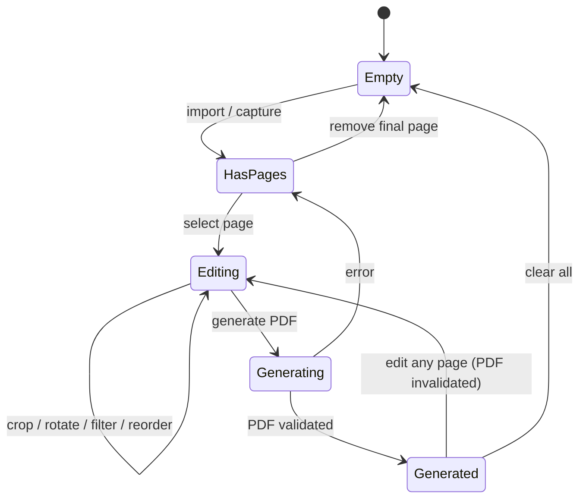
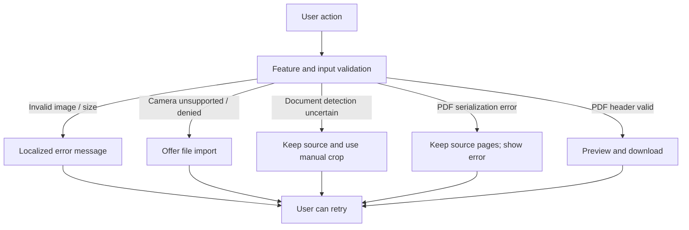

# DocTake

**DocTake** is a bilingual (English/Japanese), responsive, browser-based photo-to-PDF application. It captures images from a device camera or imports existing photographs, lets the user rotate, crop, and enhance each page, and assembles the pages into a downloadable PDF.

The project deliberately contains only two files:

```text
/DocTake/
├── index.html
└── README.md
```

The application core does not require a build step, package manager, backend, account, or PDF-generation CDN. It uses browser APIs and a small local PDF writer. Optional framework and graphics experiments run in a sandboxed iframe and do not control the main application DOM.

> Reliability note: no web application can guarantee error-free operation on every browser, device, camera driver, or network. DocTake uses feature detection and graceful failure messages, but camera access and image decoding remain dependent on browser capabilities. Test the target devices before production use.

## 1. Features

### Capture and import

- Camera capture through `navigator.mediaDevices.getUserMedia()`.
- Rear/front camera preference switching when the device exposes both cameras.
- Local import of multiple image files.
- Drag-and-drop image import.
- Page ordering, removal, and selection.
- Per-file size limit of 25 MB and a 40-page application limit.
- Image decoding and normalization through `createImageBitmap()` with an `Image` fallback.

### Image processing

- Preview rendering using Canvas 2D.
- 90-degree rotation in either direction.
- Manual edge trimming (left, right, top, bottom).
- Brightness, contrast, grayscale mix, and saturation controls.
- Color, grayscale, and threshold-based black-and-white scan modes.
- Optional light noise smoothing and edge sharpening filters (simple spatial kernels, not AI restoration).
- Experimental automatic document boundary estimation and perspective rectification.
- Source images are normalized to a maximum dimension of 3,000 pixels; PDF page images are capped at 2,600 pixels.

**Automatic detection limitation:** the built-in detector is a lightweight threshold/brightness heuristic, not a trained document-segmentation model. It is most useful when a light sheet of paper contrasts with a darker background. Busy, low-contrast, colored, curved, or poorly lit scenes may fail or produce inaccurate corners. Inspect the output and use manual crop/rotation where necessary. This is not a substitute for a production scanner SDK or a robust OpenCV contour pipeline.

### PDF output

- Multi-page PDF creation in the browser.
- Batch export: create one single-page PDF per source page and package the PDFs into a ZIP file locally (stored ZIP entries; no compression).
- A4, A5, US Letter, and custom page dimensions (50–500 mm).
- Portrait, landscape, and per-page automatic orientation.
- Configurable margins.
- Compact, balanced, and high JPEG quality profiles.
- Optional page numbers.
- PDF preview using a browser `blob:` URL.
- Header validation (`%PDF-`) before the file is presented as generated.
- UTF-16BE title metadata. Standard PDF Helvetica is used for page numbers; Japanese glyph embedding is not included, so the Japanese document title is metadata rather than printed Japanese text.

The PDF writer embeds JPEG streams as image XObjects and creates the Catalog, Pages, Page, Contents, Font, Info, and cross-reference objects locally. It does not upload images or invoke a third-party PDF service.

### Localization and appearance

- English and Japanese interface strings.
- Language switching without a reload.
- Light, Dark, and System appearance modes.
- System theme support through `prefers-color-scheme`.
- Responsive layouts for desktop, tablet, and mobile.
- Keyboard-accessible file import and page selection.
- Reduced-motion preference support.

### Privacy

- Images are held in page memory only; no automatic cloud upload exists.
- Camera tracks are stopped when the camera dialog closes or the page unloads.
- The generated PDF is held as a browser `Blob` and object URL.
- The theme preference is stored in `localStorage`; document images and PDF files are not persisted there.
- Refreshing or closing the tab clears the in-memory document. The user can also use **Clear all**.
- Optional integrations load remote resources only when the user explicitly chooses an item in the integration lab. This necessarily makes a network request to that third-party CDN.

## 2. Run locally

### Recommended: local HTTP server

Camera APIs normally require a secure context. `https://` and `http://localhost` are secure contexts in modern browsers; opening the file directly using `file://` may disable camera access.

With Python 3:

```bash
cd /path/to/DocTake
python3 -m http.server 8000
```

Open:

```text
http://localhost:8000/
```

With Node.js (if installed):

```bash
cd /path/to/DocTake
npx --yes http-server -p 8000
```

Then open `http://localhost:8000/`.

### Deploy

Upload the `DocTake` directory to any static host that serves `index.html` over HTTPS. No server-side API is needed for the core workflow. Configure the host not to inject HTML transformations that rewrite the inline script.

## 3. User workflow

1. Select **Use camera** or **Choose images**.
2. Grant camera permission when prompted, or import one or more image files.
3. Select a thumbnail in **Pages**.
4. Optionally use **Detect & straighten document**, rotation, crop, brightness, contrast, saturation, scan mode, noise smoothing, and sharpening controls.
5. Move pages up or down to set document order.
6. Choose paper size, orientation, margins, image quality, document title, and page-number setting.
7. Select **Generate PDF**.
8. Review the embedded PDF preview and choose **Download PDF**.
9. Use **Clear all** to remove the in-memory source pages and generated output.

## 4. Architecture

### Core principles

- **Local-first:** acquisition, image operations, and PDF writing are client-side.
- **One owner for the core DOM:** the application uses vanilla JavaScript. No optional framework is initialized against the same main-app elements.
- **Explicit optionality:** one optional technology can be evaluated in the sandbox at a time.
- **Graceful degradation:** if camera access is unavailable, image import remains available. If automatic document detection fails, manual crop and rotation remain available.
- **Bounded resources:** image dimensions, file sizes, and page count are capped to reduce memory pressure.

### Application architecture



### File structure



### Camera acquisition



### Image-processing pipeline



### PDF generation



### Interaction and page state



### Error handling and recovery



## 5. Technology inventory and compatibility decisions

The list below includes every technology family and named item from the project proposal and its appended inventory. Inclusion in this catalog does **not** mean that every item is loaded by default or is necessary for photo-to-PDF conversion.

### Primary application stack

| Technology | DocTake role | Decision |
|---|---|---|
| HTML5 | Document structure and controls | Core |
| CSS3 | Responsive design, theme tokens, focus states | Core |
| JavaScript | State, orchestration, event handling | Core |
| Canvas 2D | Image transformation and preview | Core |
| MediaDevices / `getUserMedia` | Camera access | Core, feature-detected |
| Blob, File, URL APIs | File handling and PDF output | Core |
| PDF serialization | Local PDF object writer | Core, no external package |
| WebGL | Optional GPU graphics API | Not needed for ordinary scanning |

### Frontend frameworks and interaction systems

| Name | Intended role | Compatibility approach |
|---|---|---|
| HTMX / htmx | Hypermedia requests and server-rendered fragments | Optional sandbox; requires a backend for useful network actions |
| Datastar | Server-driven reactive HTML and signals | Optional sandbox; backend/SSE needed for server features |
| Alpine.js | Small declarative interactions | Optional sandbox |
| Unpoly | Progressive enhancement and fragment navigation | Optional sandbox |
| Stimulus | Controller-oriented behavior | Optional sandbox |
| Turbo | Navigation and frame/stream updates | Optional sandbox; server integration required |
| Vue.js | Component-oriented reactive UI | Optional sandbox |
| Petite-Vue | Small Vue-like progressive enhancement | Optional sandbox |
| `_hyperscript` / hyperscript | Declarative DOM behavior | Optional sandbox |

Do not mount these frameworks on the same application elements. They have overlapping state and DOM ownership models. DocTake's core is intentionally framework-independent.

### HTMX extension names

Current htmx releases distinguish extension and compatibility features across versions. The contemporary htmx extension catalog includes `hx-ws`, `hx-multipart`, `hx-live`, `hx-pending`, `hx-preload`, `hx-history-cache`, `hx-head`, `hx-download`, `hx-targets`, `hx-upsert`, `hx-csp`, and `hx-alpine-compat`. A bundled `htmax` distribution can make a number of extensions available together. Check the exact release documentation before relying on an attribute in a deployment.

| Requested name | Treatment |
|---|---|
| `hx-see` | Not found as an official htmx extension. Likely intended to be `hx-sse` (Server-Sent Events); confirm before use. |
| `hx-ws` | Official WebSocket extension; requires a compatible WebSocket server. |
| `hx-multipart` | Official multipart streaming extension; requires a compatible server response. |
| `hx-live` | htmx reactive bindings. |
| `hx-pending` | Pending/loading UI behavior. |
| `hx-preload` | Preload behavior for linked/requested content. |
| `hx-history-cache` | History caching; review storage/privacy implications before enabling. |
| `hx-head` | Head-element merge behavior during swaps. |
| `hx-download` | Download-oriented response handling. |
| `hx-targets` | Target multiple elements. |
| `hx-upsert` | Insert-or-update swap behavior. |
| `hx-csp` | CSP-related support; does not replace a properly designed Content Security Policy. |
| `hx-alpine-compat` | Compatibility helper for htmx and Alpine.js. |

The static DocTake application has no backend routes, server-sent events endpoint, multipart streaming endpoint, or WebSocket server. Consequently, server-oriented htmx features cannot provide useful document processing in the standalone project. They are integration candidates for a future hosted collaboration or processing service.

### Alpine.js plugin family

The requested plugins are represented in the integration catalog: **Collapse, Focus, Intersect, Mask, Morph, Persist, Resize, Sort, and Anchor**. These are add-on modules; load the compatible Alpine core first and follow the plugin's version/order requirements. They are not loaded into DocTake's main document.

### CSS frameworks, components, and design systems

| Name | Classification / notes |
|---|---|
| Tailwind CSS | Utility-first CSS framework. |
| Tailwind Browser | Browser/Play CDN build; convenient for prototypes, not the preferred production build. |
| Tailwind Play CDN | Browser-based Tailwind prototyping; treated as the same general runtime path as Tailwind Browser. |
| daisyUI | Tailwind component plugin/theme system; requires a compatible Tailwind setup. |
| Bootstrap | CSS and JavaScript component framework. |
| Bootstrap Components | Components provided by Bootstrap, not a separate framework. |
| Bulma | CSS framework. |
| Pure.css | Small CSS framework. |
| UIkit | CSS and JavaScript UI framework. |
| UIkit Components | Components included with UIkit, not a separate framework. |
| Flowbite | Tailwind-based component library. |
| Semantic UI | CSS component framework. |
| Fomantic UI | Community-maintained Semantic UI continuation. |
| Simple.css | Class-light CSS framework. |
| Blades CSS | CSS framework distributed through the `@anyblades/blades` package. |
| Open Props | CSS custom-property design tokens and associated stylesheets. |
| Materialize CSS | Material Design-inspired CSS framework. |
| Pico CSS | Class-light semantic HTML framework. |
| Web Awesome | Web component/icon ecosystem; check the official package instructions for the chosen release. |
| Iconify Icon | Icon web component (`iconify-icon`). |
| Uno CSS / UnoCSS Runtime | On-demand atomic CSS engine/runtime. |
| EaseMotion CSS / EaseMotionCSS | Exact canonical package/CDN could not be verified under this name. Provide its official repository/package URL before enabling. |

Only the core stylesheet is active in DocTake. The integration lab isolates selected framework styles in a sandboxed iframe to avoid global resets and selector collisions.

### Animation and visual effects

- **Animate.css** — CSS animation utility classes.
- **Hover.css** — hover/focus effect classes.
- **Magic Animations** — CSS animation class collection.
- **Open Props Animations** — animation tokens/keyframes from Open Props.
- **transition.css** — ambiguous name; identify the exact package/repository before adding a URL.
- **EaseMotion CSS** — unresolved project name; no URL is fabricated.

### Graphics and visualization

| Technology | Role / status |
|---|---|
| WebGL | Native browser GPU graphics API; no external runtime required. |
| p5.js | Creative coding library; optional sandbox integration. |
| Processing.js | Legacy Processing port; retained in the catalog for compatibility research, not recommended for new work. |
| Three.js | 3D rendering library; optional sandbox integration. |

These libraries do not improve the core document-scanning pipeline by themselves. They are suitable for optional visual effects, education, or 3D document demonstrations, not as replacements for robust image processing.

### Development and IDE tooling

- **Tailwind CSS IntelliSense** — Visual Studio Code extension for class completion and diagnostics.
- **Visual Studio Code Marketplace** — distribution marketplace, not a browser library.
- **Emmet** — editor abbreviation expansion.
- **Datastar IDE Support** — editor tooling.
- **VS Code Extensions** — category of editor add-ons.

IDE tools belong in the developer environment and cannot be meaningfully loaded into the deployed `index.html` page.

### Optional library loading lab

The **Optional integration lab** lists the named technologies and loads supported browser resources only after the user presses **Try**. The preview is a sandboxed iframe with no same-origin permission, so its scripts cannot reach DocTake's main DOM or in-memory page state. The current catalog uses versioned CDN entries for htmx 4.0.1, Unpoly 3.15.0, Stimulus 3.2.2, Turbo 8.0.23, Petite-Vue 0.4.1, `_hyperscript` 0.9.94, p5.js 2.4.0, Three.js 0.187.0, and Flowbite 4.0.1. daisyUI uses the official major-version CDN form (`daisyui@5`) together with Tailwind Browser (`@tailwindcss/browser@4`). Check the catalog URLs against the official release pages before deploying; major-version CDN tags can advance.

Some catalog items intentionally display documentation-only notes because an exact canonical package, verified URL, or useful standalone browser build could not be established. A documentation label is not an assertion that the library has been integrated into the core app.

## 6. Security and privacy considerations

- Use HTTPS for deployment and camera access.
- Do not add an upload endpoint without explicit user action, consent, and a clear retention policy.
- Treat image metadata and file names as untrusted input. The current UI uses `textContent` for user-provided file names rather than injecting them as HTML.
- Preserve the per-file byte cap and source-dimension cap when changing the importer.
- A browser tab can still run out of memory with many high-resolution photos; the app limits the count and dimensions but cannot guarantee a specific device's available memory.
- The optional integration iframe intentionally omits `allow-same-origin`. Third-party code runs in an opaque-origin sandbox.
- A production deployment should add an HTTP Content Security Policy (CSP) at the hosting layer. A restrictive CSP must explicitly allow the CDN origins selected for optional libraries. Avoid `unsafe-eval` where possible; some development CDNs or frameworks may require it.
- The current inline script and style blocks mean a strict CSP needs nonce/hash configuration or a build/deployment adjustment. Do not copy a generic CSP header without testing the inline script and optional CDN resources.
- No OCR is implemented. OCR would require an additional language model/engine and Japanese trained data; it should be added as an explicit optional feature with privacy and performance review.

## 7. Browser compatibility and limitations

Test current stable releases of Chrome, Edge, Firefox, and Safari on desktop and mobile. Exact behavior varies by browser, operating system, device camera, and hardware acceleration.

| Capability | Requirement / fallback |
|---|---|
| Camera | `getUserMedia`, user permission, HTTPS or localhost. Use image import if unavailable. |
| Image import | Browser-supported image decoder and Canvas 2D. HEIC/HEIF support varies by browser; convert to JPEG/PNG if decoding fails. |
| `createImageBitmap` | Used when available; `Image` element fallback is provided. |
| Canvas 2D | Required for image preview and export. |
| `canvas.toBlob` | Required for JPEG encoding in the local PDF writer. |
| PDF preview | Browser PDF viewer; downloading remains available if inline preview is unsupported. |
| `localStorage` | Used only for theme preference; failures are ignored. |
| `prefers-color-scheme` | Optional system-theme integration. |

### Known limitations

1. No OCR, automatic text extraction, translation, searchable PDF layer, form recognition, or classification.
2. Automatic document edge finding is heuristic and not reliable on every background or lighting condition.
3. Manual crop is edge trimming rather than a draggable four-corner polygon editor.
4. Perspective correction uses a custom homography resampler; it is functional but not a computer-vision SDK replacement.
5. Image output is JPEG-based, so it is optimized for photographs/scans rather than lossless archival preservation.
6. The PDF uses built-in Helvetica for page numbers. It does not embed Japanese fonts or print the document title as Japanese text.
7. No password protection, PDF/A conformance, signatures, metadata sanitization, or PDF accessibility tagging is implemented.
8. Custom paper dimensions are limited to 50–500 mm.
9. All page image data is memory-resident. There is no IndexedDB persistence or automatic recovery after refresh.
10. Optional integrations depend on third-party CDNs and may change availability or versions. Core scanning and PDF generation do not depend on them.

## 8. Troubleshooting

### The camera button does not open the camera

- Serve the application from `http://localhost` or HTTPS, not an ordinary insecure LAN address or `file://` URL.
- Check the browser's camera permission for the site.
- Close other applications or browser tabs using the camera.
- Confirm the operating system has granted browser camera access.
- Use **Choose images** as a fallback.

### A file is skipped or cannot be decoded

- Use JPEG, PNG, or WebP when possible.
- Convert HEIC/HEIF to JPEG if the browser does not support that codec.
- Keep each file below 25 MB.
- Avoid damaged or partially downloaded image files.

### Automatic detection does not find the paper

- Use a contrasting background and even lighting.
- Avoid shadows, colored patterns, and objects crossing the paper edge.
- Rotate the page and use the four manual trim sliders.
- Review the result at full size before exporting.

### PDF generation fails or the page becomes slow

- Reduce the number of pages or image quality.
- Close other memory-intensive tabs.
- Import smaller images or reduce their resolution before importing.
- Try a current desktop browser if a mobile device runs out of memory.

### Optional integration does not load

- Check the network connection and browser console.
- Some package URLs, versions, or globals change; check the library's official documentation.
- Some items are not browser runtimes or do not have a verified URL. These are marked documentation-only in the integration catalog.
- Server-dependent technologies (htmx requests, Datastar streams, Turbo Streams, WebSockets) need a compatible backend endpoint.

## 9. Test checklist

### Smoke test performed for this source snapshot

A headless Chromium 144.0.7559.96 run exercised multiple PNG imports, Japanese localization, Dark Mode, automatic boundary detection, black-and-white mode, saturation, noise reduction, sharpening, reset, rotation, page reordering, two-page PDF generation and download, and batch ZIP export. The exported PDF opened as a two-page document; the ZIP passed its integrity check and each embedded PDF opened as a single-page document. The 390-pixel mobile viewport had no horizontal overflow. No JavaScript page exceptions or browser-console errors were recorded in that run.

This smoke test does not certify every browser/device combination. Physical camera capture, camera permission behavior, HEIC decoding, remote optional CDN integrations, long documents, and real mobile-device memory limits still require testing on the intended hardware.

Before a release, run at least the following checks on the browsers/devices your users support:

- [ ] Launch over localhost and HTTPS.
- [ ] Import one JPEG, PNG, and WebP file.
- [ ] Test a corrupt file, unsupported image format, and file larger than 25 MB.
- [ ] Import multiple files and reorder/remove pages.
- [ ] Test camera permission allow, deny, and unavailable-device paths.
- [ ] Capture with front and rear cameras where available.
- [ ] Test rotation, each crop edge, brightness, contrast, grayscale, reset, and automatic detection.
- [ ] Generate A4, A5, Letter, and custom-size PDFs.
- [ ] Generate a batch ZIP and confirm each contained PDF opens correctly.
- [ ] Test portrait, landscape, and automatic orientation.
- [ ] Check margins, page numbers, image quality, title metadata, and page count.
- [ ] Open the generated PDF preview and downloaded file in at least two PDF readers.
- [ ] Verify Japanese and English text, Light/Dark/System themes, and mobile layout.
- [ ] Verify that no network request containing image content is made by the core application.
- [ ] Verify the optional integration sandbox cannot access the parent document.
- [ ] Test large multi-page documents on low-memory devices.

## 10. Licensing and third-party resources

DocTake's application source is provided as project code; choose and add an explicit project license before redistribution. Optional third-party packages retain their own licenses and terms. Examples include MIT/BSD-style packages, framework-specific licenses, and separately licensed icon sets. Verify the exact package license, attribution requirements, CDN terms, and version before shipping or bundling any optional integration.

CDN URLs in the optional catalog are pinned where a release was selected, but availability and package contents can change. The Tailwind browser runtime and some optional runtime entries use major-version or rolling CDN paths for convenience; production deployments should pin an exact tested patch version and consider self-hosting approved assets. The optional integration lab is a development/compatibility aid, not a production dependency manager.

## 11. Roadmap

1. Add a draggable four-corner crop editor with zoom and touch handles.
2. Improve document detection with a maintained OpenCV.js build or a dedicated segmentation model.
3. Add OCR with Japanese and English language data and a selectable local/remote processing policy.
4. Add PDF page templates, searchable text layer, embedded CJK fonts, and metadata editing.
5. Add page presets and optional local IndexedDB projects with explicit user consent.
6. Add automated browser tests and device-specific performance profiles.
7. Add a backend only if collaboration, remote storage, server rendering, or streaming integrations are required.

---

**Generated via ChatGPT**

## 12. Reference documentation

Use the project's own release documentation when enabling optional integrations:

- [htmx 4 documentation and extension catalog](https://four.htmx.org/docs)
- [htmx releases](https://github.com/bigskysoftware/htmx/releases)
- [Datastar getting started guide](https://data-star.dev/guide/getting_started)
- [Tailwind CSS Play CDN documentation](https://tailwindcss.com/docs/installation/play-cdn)
- [daisyUI CDN instructions](https://daisyui.com/docs/cdn/)
- [Flowbite CDN instructions](https://flowbite.com/docs/getting-started/introduction/)
- [Unpoly CDN installation](https://unpoly.com/learn/install)
- [Stimulus package](https://www.npmjs.com/package/@hotwired/stimulus)
- [Turbo installation guide](https://turbo.hotwired.dev/handbook/installing)
- [Petite-Vue package](https://www.npmjs.com/package/petite-vue)
- [_hyperscript installation guide](https://hyperscript.org/docs/getting-started/)
- [Alpine.js documentation](https://alpinejs.dev/)
- [Vue.js documentation](https://vuejs.org/)
- [p5.js download and CDN instructions](https://p5js.org/download/)
- [Three.js installation guide](https://threejs.org/manual/en/installation.html)
- [Blades CSS installation guide](https://blades.ninja/css/)

The Tailwind browser/Play CDN is intended for development and experimentation, not as the normal production build path. daisyUI's CDN instructions pair its stylesheet with the Tailwind browser runtime; Flowbite also expects a compatible Tailwind environment. Datastar and Turbo offer ES-module distributions; server-driven features still require compatible backend responses. Three.js is loaded as an ES module and does not create a global `THREE` variable in this preview. htmx 4 has a migration boundary from htmx 2; pin and test the exact release rather than assuming attributes and extension packages are interchangeable across major versions.
